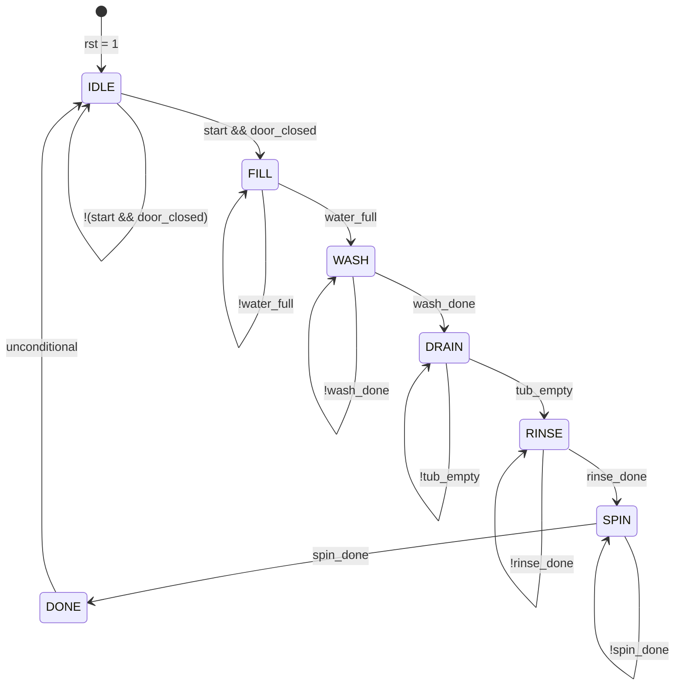

# SystemVerilog Washing Machine FSM Controller

A synthesizable, Moore Finite State Machine (FSM) implementation of an automatic washing machine controller designed in SystemVerilog. The project includes the RTL controller and a self-monitoring verification testbench for cycle validation.

---

## Table of Contents
- [Overview](#overview)
- [FSM Architecture](#fsm-architecture)
  - [State Diagram](#state-diagram)
  - [State Encoding & Output Truth Table](#state-encoding--output-truth-table)
- [Module Interface](#module-interface)
  - [Input Signals](#input-signals)
  - [Output Signals](#output-signals)
- [Project Structure](#project-structure)
- [Simulation & Verification](#simulation--verification)
  - [Prerequisites](#prerequisites)
  - [Command-Line Simulation (ModelSim / QuestaSim)](#command-line-simulation-modelsim--questasim)
  - [GUI Simulation & Waveform Inspection](#gui-simulation--waveform-inspection)
  - [Sample Simulation Output](#sample-simulation-output)
- [Design Highlights](#design-highlights)

---

## Overview

The washing machine controller models an automatic wash cycle divided into sequential phases: filling, washing, draining, rinsing, spinning, and completion.

Key characteristics:
- **FSM Style**: Moore Finite State Machine (outputs depend strictly on the current state).
- **Architecture**: Clean 3-process / 3-block partitioned design:
  1. Synchronous state register with asynchronous active-high reset (`always_ff`).
  2. Combinational next-state decoding (`always_comb`).
  3. Combinational output decoding with default value assignments to prevent latches (`always_comb`).
- **Safety Interlock**: Prevents machine startup unless `door_closed` is asserted alongside `start`.

---

## FSM Architecture

### State Diagram



### State Encoding & Output Truth Table

The controller uses an explicit 3-bit enumerated type (`state_t`):

| State Name | Binary Encoding | `inlet_valve` | `wash_motor` | `drain_pump` | `spin_motor` | `done` | Description / Action |
|:-----------|:---------------:|:-------------:|:------------:|:------------:|:------------:|:------:|:---------------------|
| `IDLE`     | `3'b000`        | 0             | 0            | 0            | 0            | 0      | Standby state; all actuators off |
| `FILL`     | `3'b001`        | **1**         | 0            | 0            | 0            | 0      | Water inlet valve open until tub is full |
| `WASH`     | `3'b010`        | 0             | **1**        | 0            | 0            | 0      | Agitation / wash motor running |
| `DRAIN`    | `3'b011`        | 0             | 0            | **1**        | 0            | 0      | Drain pump extracting dirty wash water |
| `RINSE`    | `3'b100`        | **1**         | **1**        | 0            | 0            | 0      | Fresh water intake & drum agitation |
| `SPIN`     | `3'b101`        | 0             | 0            | 0            | **1**        | 0      | High-speed centrifugal spin drying |
| `DONE`     | `3'b110`        | 0             | 0            | 0            | 0            | **1**  | Wash sequence finished; asserts completion flag |

---

## Module Interface

### Input Signals

| Signal Name   | Width | Active Level | Description |
|:--------------|:-----:|:------------:|:-------------------------------------------------------|
| `clk`         | 1-bit | Rising edge  | System clock signal |
| `rst`         | 1-bit | High         | Asynchronous master reset (returns FSM to `IDLE`) |
| `start`       | 1-bit | High         | User push-button / trigger to initiate wash cycle |
| `door_closed` | 1-bit | High         | Safety door switch sensor (must be closed to start) |
| `water_full`  | 1-bit | High         | Pressure switch / water level sensor |
| `wash_done`   | 1-bit | High         | Wash timer completion trigger |
| `tub_empty`   | 1-bit | High         | Water drainage level sensor |
| `rinse_done`  | 1-bit | High         | Rinse phase timer completion trigger |
| `spin_done`   | 1-bit | High         | Spin phase timer completion trigger |

### Output Signals

| Signal Name   | Width | Description |
|:--------------|:-----:|:---------------------------------------------------|
| `inlet_valve` | 1-bit | Water solenoid valve control (`1` = open valve) |
| `wash_motor`  | 1-bit | Low-speed agitator / wash drum motor control |
| `drain_pump`  | 1-bit | Discharge pump control (`1` = pump active) |
| `spin_motor`  | 1-bit | High-speed spin extraction motor control |
| `done`        | 1-bit | Cycle completed indicator strobe/flag |

---

## Project Structure

```text
washing_machine_fsm_sv/
├── washing_machine.sv      # RTL design: Moore FSM implementation
├── washing_machinetb.sv    # Verification testbench: clock generation & stimulus
├── modelsim.ini            # ModelSim environment configuration
├── README.md               # Project documentation
└── work/                   # Compiled simulation library directory
```

---

## Simulation & Verification

### Prerequisites
- ModelSim / QuestaSim (e.g., Intel FPGA Edition), Vivado, Synopsys VCS, or Icarus Verilog (with SystemVerilog flags enabled).

### Command-Line Simulation (ModelSim / QuestaSim)

1. **Create the working library (if not already created):**
   ```bash
   vlib work
   ```

2. **Compile the design and testbench:**
   ```bash
   vlog washing_machine.sv washing_machinetb.sv
   ```

3. **Run simulation in batch/CLI mode:**
   ```bash
   vsim -c -do "run -all; quit" washing_machine_tb
   ```

### GUI Simulation & Waveform Inspection

To launch the simulation with interactive waveform debugging:

```bash
vsim -gui work.washing_machine_tb
```

In the ModelSim GUI console:
```tcl
add wave -r /*
run -all
```

### Sample Simulation Output

```text
# Loading sv_std.std
# Loading work.washing_machine_tb
# Loading work.washing_machine
# run -all
# Time=0 | State=IDLE | Valve=0 | Wash=0 | Drain=0 | Spin=0 | Done=0
# Time=25 | State=FILL | Valve=1 | Wash=0 | Drain=0 | Spin=0 | Done=0
# Time=45 | State=WASH | Valve=0 | Wash=1 | Drain=0 | Spin=0 | Done=0
# Time=65 | State=DRAIN | Valve=0 | Wash=0 | Drain=1 | Spin=0 | Done=0
# Time=85 | State=RINSE | Valve=1 | Wash=1 | Drain=0 | Spin=0 | Done=0
# Time=105 | State=SPIN | Valve=0 | Wash=0 | Drain=0 | Spin=1 | Done=0
# Time=125 | State=DONE | Valve=0 | Wash=0 | Drain=0 | Spin=0 | Done=1
# Time=135 | State=IDLE | Valve=0 | Wash=0 | Drain=0 | Spin=0 | Done=0
# ** Note: $finish    : washing_machinetb.sv(102)
```

---

## Design Highlights

- **Standard SystemVerilog Constructs**: Uses `logic`, `typedef enum`, `always_ff`, and `always_comb` ensuring clear synthesis intent and avoiding simulation/synthesis mismatches.
- **Latch-Free Output Logic**: Every combinational block defines default output values prior to the `case` statement to prevent unintended latch inference during synthesis.
- **Safety Interlocking**: Includes the `door_closed` condition in the `IDLE` transition logic to prevent cycle start while the door is open.
- **Clean State Recovery**: Default case statements ensure the state machine safely falls back to `IDLE` in the event of invalid state transitions (e.g., single-event upsets).

